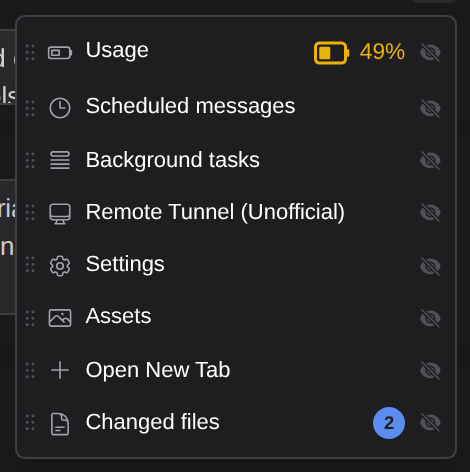
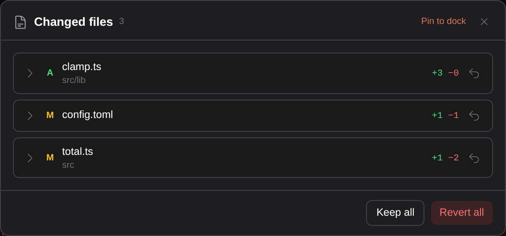
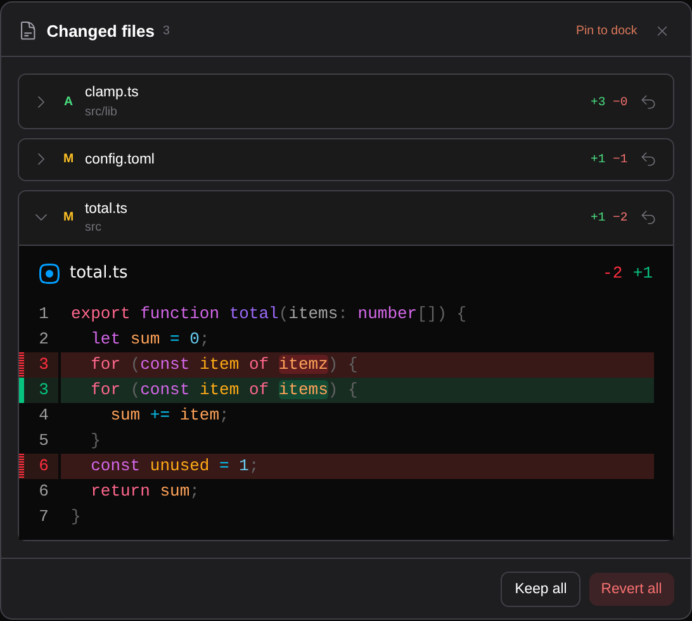
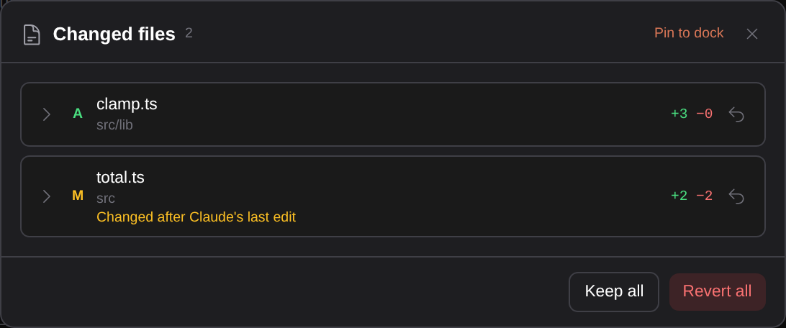
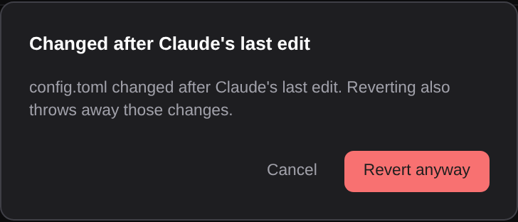
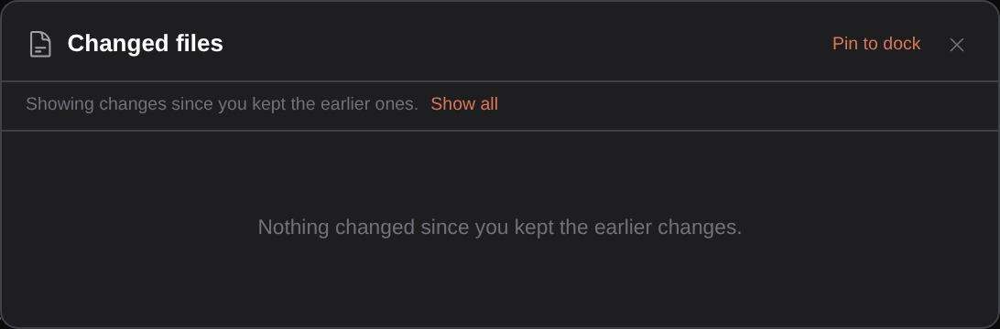

# See every file Claude changed in a session, and put any of them back

> Language: **English** · [한국어](./ko.md)

After a long turn it was hard to say what Claude had actually touched. The edits were there as cards in the chat, but spread across the conversation, one card per edit, and the only way back was to undo by hand or rewind the whole conversation. The **Changed files** panel lists the files the session changed, with how much each changed, its diff, and a **Revert** button that puts that one file back to how it was before Claude touched it. Ported from the CC GUI plugin's status panel.

## Opening it

**Changed files** is in the ⋮ menu at the top right of the chat, with a badge counting the files. **Pin to dock** in the panel (or the eye in the menu) puts its icon next to the menu, where it shows the same count and stays hidden while the session has changed nothing.

## The list

Each row is one file, newest change first:

- **A** for a file Claude created, **M** for one it changed.
- The name (click it to open the file in the editor) and, below it, its folder in the project.
- **+N −M**: lines added and removed between the file as it was before Claude's first change in the session and the file as it is now. A file that is back to how it was, by any means, drops off the list.
- The arrow on the right is **Revert**.

Edits made by subagents count too: they are part of the session.

## The diff

The arrow on the left of a row shows the diff: the file before Claude changed it on one side, the file now on the other. It is read from the disk each time, so it includes anything changed since.

## Revert

**Revert** asks first, then puts the file back to how it was before Claude's first change in this session. A file Claude created is deleted, and the question says so. Open editors reload the file. **Escape** closes the panel without stopping a running reply.

If the file changed after Claude last edited it (you edited it, or another tool did), the row says **Changed after Claude's last edit**, and Revert asks a second time:

**Revert anyway** puts the file back regardless; **Cancel** leaves it alone.

**Revert all** reverts every file in the list that can be reverted, after one question. Files that changed after Claude's last edit are left as they are (the message says how many); revert those one at a time if you mean to.

## Keep all

**Keep all** accepts what is listed: the panel then shows only what Claude changes after that, measured from the file as you kept it.

**Show all** brings back every change of the session. Keep all is remembered per session in this browser (or this IDE's chat), not on the server: in another browser the full list is shown.

## Where it comes from

Nothing is recorded by the plugin. Claude Code writes, for every successful Edit, MultiEdit and Write, the file as it was just before (`originalFile`) and what it wrote into the session transcript. The panel reads that, and the files on disk, each time it opens and whenever a turn ends. So the list is always the transcript and the disk as they are now.

## What it does not do

- **Only Edit, MultiEdit and Write.** A file changed by a shell command (`sed`, a formatter, `git checkout`) or by NotebookEdit is not listed, because the transcript does not say what it was before. [Rewind](../056-fork_and_rewind/en.md) covers those, from Claude Code's own checkpoints.
- **It is not undo history.** Revert goes back to before Claude's first change in the session (or since Keep all), not one edit at a time. To go back to a point in the conversation, use [Rewind](../056-fork_and_rewind/en.md).
- **Files over 2 MB** are listed but not compared or reverted here.
- **A file whose earlier version is not in the transcript** (written by an older Claude Code) is listed with "Earlier version not recorded" and cannot be reverted from here.
- **A branch you left** by forking or rewinding does not count: only the conversation you are in.
- The terminal has no such panel; this is something the GUI adds on top of the same transcript.
