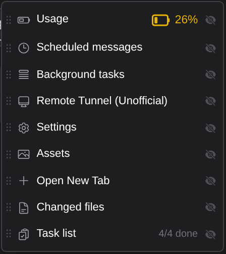
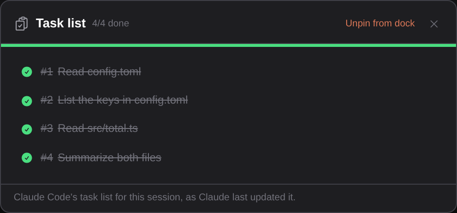
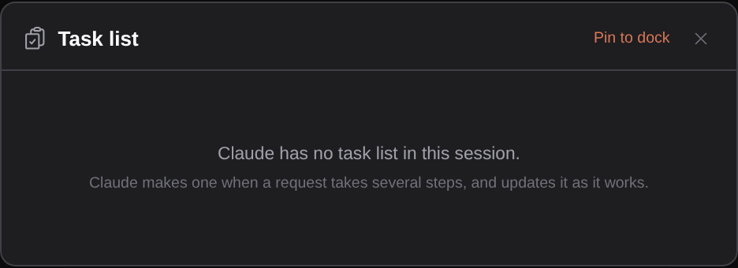
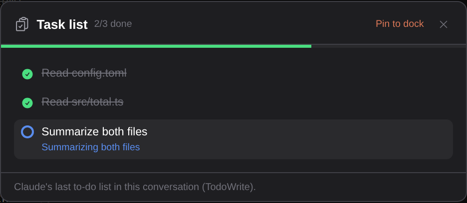

# See Claude's task list while it works

> Language: **English** · [한국어](./ko.md)

When a request takes several steps, Claude Code keeps a task list: it writes the steps down, marks the one it is on, and ticks each off as it finishes. The terminal shows that list under the prompt. In the chat it was only a trail of TaskCreate and TaskUpdate cards spread through the conversation, so "how far along is it?" meant scrolling and adding up. The **Task list** panel shows the list as it stands right now: what is done, what Claude is doing, and what is still waiting. Ported from the Tasks tab of the CC GUI plugin's status panel.

## Opening it

**Task list** is in the ⋮ menu at the top right of the chat, with how many tasks are done out of how many.

**Pin to dock** in the panel (or the eye in the menu) puts its icon next to the menu. The icon shows the same count, turns blue while Claude is working on one of the tasks, and stays hidden while the session has no list.

## The list

Tasks are in the order Claude created them, each with its number:

- A **green tick** is a finished task, struck through.
- A **blue ring** is the task Claude is on. It spins while the reply is running, and under it is what Claude is doing ("Listing config.toml keys").
- An **empty ring** is a task not started yet. Under it is its description, if Claude gave one.
- **Waiting on #2, #3** means the task depends on those and they are not finished. Finished ones drop off this line.
- When a list is shared by several agents, the name of the agent a task is assigned to is shown under it.

The bar under the title fills as tasks finish.

The panel reads the list again when it opens, every time one of Claude's task tools returns, and when a reply ends, so it moves along as Claude works. **Escape** closes it without stopping the reply.

## When there is no list

Claude does not make a list for every request, only when the work has several steps. A session without one shows this, and the dock icon stays hidden.

## Where it comes from

Nothing is stored by the plugin. The panel reads the list from where Claude Code itself keeps it:

- **Claude Code's task list.** Current Claude Code saves each task as a file in `~/.claude/tasks/<session id>/` (or under the folder `CLAUDE_CONFIG_DIR` points to, if you set one). If `CLAUDE_CODE_TASK_LIST_ID` is set, in the environment or in [Claude's environment variables](../109-env_vars/en.md), Claude Code uses that shared list instead, and so does the panel. This is the same list the terminal shows. When Claude Code clears a finished list, the panel is empty too.
- **TodoWrite.** Older Claude Code, and Claude Code with the task list turned off, kept the list in the conversation instead: each TodoWrite call carries the whole list, so the panel shows the last one. These lists have no numbers.

The line at the bottom of the panel says which one you are looking at.

## What it does not do

- **It is read-only.** Claude writes the list; the panel shows it. To add, change or drop a task, ask Claude.
- **A task left in progress stays in progress.** If a reply ends (or you stop it) while Claude is on a task, the panel shows that task as in progress, with a ring that no longer spins, because that is what Claude last wrote. It does not guess that the task finished.
- **Claude only keeps a list when Claude Code gives it the task tools.** Whether it does depends on the Claude Code version and the model. In the version we checked (Claude Code 2.1.296), the newest models did not get them unless `CLAUDE_CODE_ENABLE_TODO_TOOLS=1` was set in Claude's environment ([Settings → General → Environment variables](../109-env_vars/en.md) can set it). That is Claude Code's own choice, and it is the same in the terminal: when Claude has no task tools, there is no list to show.
- **Agent teams.** When agents work as a team, Claude Code keeps the list under the team's name. The panel does not follow that yet; it shows the session's own list.
- If a subagent changes the list, the panel catches up when the reply ends: the subagent's tool calls are not in the chat.
