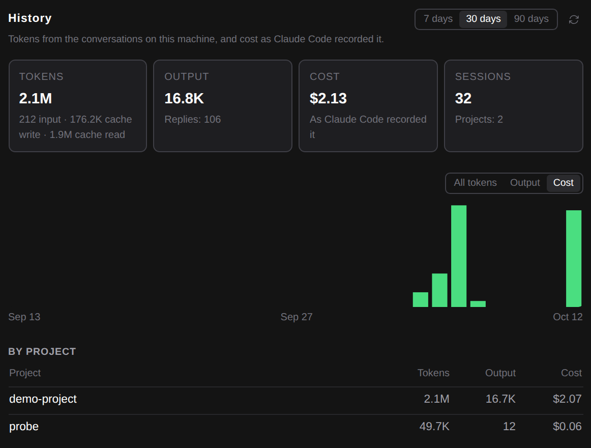

# See how much you used Claude over the last days, and what it cost

> Language: **English** · [한국어](./ko.md)

**Settings → Usage** showed how much of your plan's limits is left right now. It did not show how much you actually used over time: which days were heavy, which project took most of it, what it cost. The new **History** section, below the limits, shows that for the last 7, 30 or 90 days. Ported from the CC GUI plugin's usage dashboard. CC GUI gets its dashboard from a separate tool it installs and runs; here it is read straight from the conversations Claude Code already keeps on your machine, so there is nothing to install.

## The history

Pick **7 days**, **30 days** or **90 days** at the top right. A period ends today and starts at midnight, in your own time zone, so "7 days" is today and the six days before it. The arrow next to them reads the conversations again.

The four tiles add up the period:

- **Tokens**: everything Claude read and wrote. Under it, how that splits into new input, input written to the prompt cache, and input read back from the cache. Reading from the cache is usually most of it: Claude Code sends the conversation so far with every request, and the cache is what keeps that cheap.
- **Output**: what Claude wrote, and how many replies that was.
- **Cost**: what Claude Code worked out these replies cost (see below).
- **Sessions**: the conversations Claude replied in, and in how many projects.

## The chart

One bar per day. **All tokens** stacks output, input and cache writes, and cache reads; **Output** shows only what Claude wrote; **Cost** shows what was spent each day. Hover a bar to see that day's tokens, output and cost.

## By project and by model

**By project** lists the projects (the folder Claude Code ran in, by its name; hover it for the full path) with their tokens, output and cost, largest first. **By model** lists the models that replied, with their tokens and output. It has no cost column, because Claude Code records cost per session, not per model, and this page does not price tokens itself. Each table shows six rows; **Show all** shows the rest.

## Where the numbers come from

Nothing is recorded by the plugin. Claude Code writes every conversation to `~/.claude/projects/` (or under the folder `CLAUDE_CONFIG_DIR` points to), and each reply there carries the token counts the API sent back. The history reads those:

- **Each reply is counted once.** Claude Code writes a reply as several entries, one per part, each with the same counts. A conversation copied into a [fork](../056-fork_and_rewind/en.md) is not counted again either.
- **Subagents count.** Their replies are in their own files next to the conversation, and they are read too.
- **Cost is Claude Code's own figure**, the one `/cost` shows for a session. When a session's Claude Code process ends, Claude Code writes its running total into the conversation, and carries it on when the session is resumed. The cost of a period is how much those totals grew in it.

The first time, the history reads every conversation changed in the period (about a second per 100 MB of conversations, measured). After that only conversations that changed are read again.

## What it does not do

- **A session that is still open has its cost added later.** Claude Code records the cost when the session's process ends, so until then the session's tokens are counted and its cost is not. For the same reason, the cost of a long session lands on the day it ended.
- **Older conversations may have no cost.** Claude Code versions that did not record it leave those sessions with tokens only; the section says how many such sessions are in the period.
- **It is not your bill.** On a Claude subscription, this is what the same use would cost at API prices; your plan is not charged by it. If Claude Code could not price a model you used, a note says the cost shown is too low.
- **Only this machine.** Conversations from another computer, or ones you deleted, are not in it.
- The terminal has `/cost` for one session; there is no command that adds sessions up over days, which is what this section does with the same figures.
