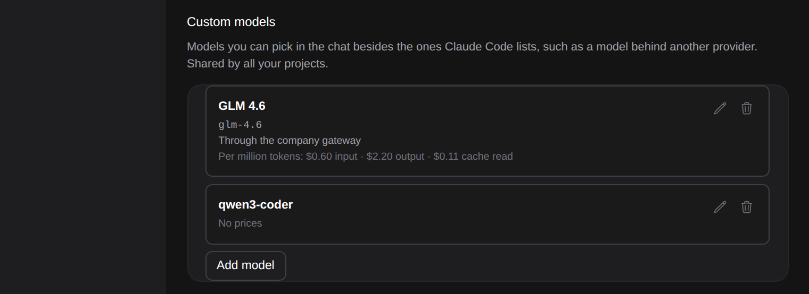
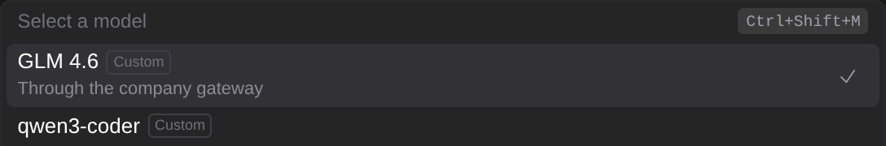
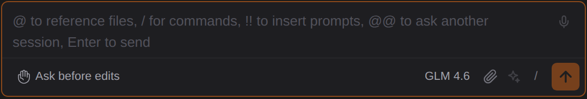

# Claude Code가 보여 주지 않는 모델을 고르고, 가격을 정하기

> Language: [English](./en.md) · **한국어**

터미널에서 `claude --model <이름>`과 `/model <이름>`은 Claude Code가 보여 주는 모델만이 아니라 엔드포인트가 아는 어떤 모델 이름이든 받습니다. 채팅의 모델 선택은 Claude Code의 목록만 보여 주므로, 다른 엔드포인트 뒤의 모델(예: [API 프로바이더](../110-api_providers/ko.md)로 연결한 게이트웨이)은 거기서 고를 수 없었습니다. **Custom models**는 그런 이름을 내가 붙인 이름으로 모델 선택에 넣어 줍니다. CC GUI 플러그인의 사용자 모델을 가져왔습니다.

## 추가하기

**설정 → Model → Custom models**에서 **Add model**을 누릅니다.

- **Model name**은 Claude Code에 넘기는 이름으로, 입력한 그대로입니다. `claude --model` 뒤에 쓰듯 한 단어이고, 목록 안에서 겹칠 수 없습니다.
- **Display name**(선택)은 모델 선택에 보일 이름입니다. 없으면 모델 이름이 보입니다.
- **Description**(선택)은 모델 선택에서 그 아래 줄입니다.
- **Prices**(선택)는 [아래](#가격)에서 설명합니다.

**Save**로 저장합니다. 이름이 없거나, 공백이 있거나, 이미 목록에 있으면 이유와 함께 거절되고 아무것도 저장되지 않습니다.

연필은 모델을 고치고, 휴지통은 물어본 뒤 목록에서 뺍니다. 사용자 모델은 프로젝트가 아니라 내 것이라, 모든 프로젝트와 설정의 두 탭이 같은 목록을 보여 줍니다.

## 고르기

사용자 모델은 모델 선택 맨 위에 오고, 각각 **Custom**이 붙습니다. 하나를 고르는 것은 터미널의 `/model <이름>`과 똑같고, 채팅에 `/model glm-4.6`을 쳐도 됩니다. 입력창 아래 모델 칩에는 내가 붙인 이름이 보입니다.

명령 팔레트의 **Switch model**과 **설정 → Model → Default Model**에도 사용자 모델이 있습니다. **Sync model changes to default**가 켜져 있으면, 터미널의 `/model`처럼 고른 모델이 새 세션의 기본값도 됩니다.

Claude Code가 같은 모델을 직접 보여 줄 때(세션이 쓰는 모델에 대해 줄을 하나 더하고, Claude Code 자체 모델을 사용자 모델로 넣을 수도 있습니다) 둘은 한 줄이 됩니다. 이름과 자리는 내 것, 모델에 대해 Claude Code가 아는 것은 그대로입니다.

## 가격

Claude Code는 세션마다 비용을 계산하고, [사용량 기록](../113-usage_history/ko.md)은 그 값을 보여 줍니다. Claude Code가 가격을 모르는 모델은 토큰만 기록하고 비용은 기록하지 않으며, 그러면 기록은 보이는 비용이 실제보다 적다고 알려 줍니다.

사용자 모델에 준 가격은 정확히 그 빈자리만 채웁니다. 사용량 기록에서만, 그 모델에 대해서만, Claude Code가 토큰은 기록했는데 비용은 없을 때만 씁니다. Claude Code가 가격을 아는 모델은 무엇을 입력해도 Claude Code의 가격을 씁니다. 가격은 100만 토큰당 미국 달러로 0부터 10,000까지이며, 그 모델에 가격을 하나라도 정했다면 비워 둔 가격은 0으로 셉니다. 기록의 비용 일부가 내가 정한 가격에서 왔다면 그래프 아래에 그렇게 적힙니다.

## 하지 않는 것

- **모델에 닿게 해 주지 않습니다.** Claude Code는 여전히 지금 쓰는 엔드포인트로 이름을 보냅니다. 그 엔드포인트가 모르는 이름은 `claude --model`과 똑같이 첫 메시지에서 엔드포인트의 오류로 실패합니다.
- **모델이 무엇을 할 수 있는지 Claude Code에 알려 주지 않습니다.** 컨텍스트 크기, effort 단계 같은 것은 Claude Code가 모르는 이름에 대해 가정하는 대로입니다.
- **목록에서 빼도 이미 그 모델로 진행 중인 채팅은 바뀌지 않습니다.** 기본값으로 정해 두었다면 기본 모델도 그대로입니다. 모델 선택이나 설정에서 바꾸세요.
- **목록은 이 컴퓨터에 저장됩니다.** `~/.claude-code-gui/entities/provider/custom_models.entity.jsonl`에 있습니다.
