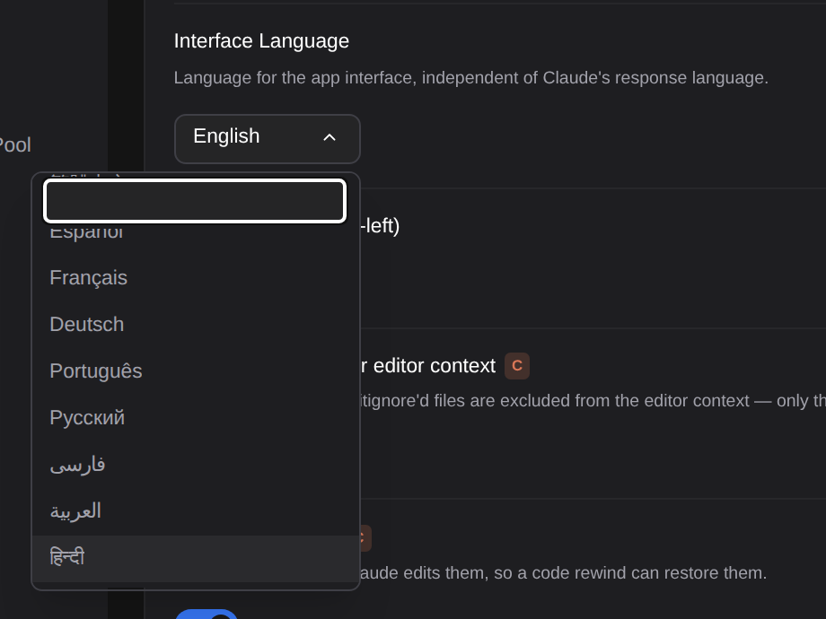

# 힌디어 인터페이스

> Language: [English](./en.md) · **한국어**

**설정 → 일반 → 인터페이스 언어**에 **हिन्दी**(힌디어)가 추가되었습니다. 고르면 설정, 채팅 화면, 도구 카드, 대화상자, 세션 목록, 알림, 앱이 뜨기 전에 보이는 불러오는 중 문구까지 인터페이스 전체가 힌디어로 그려집니다. 이미 있던 열두 개 언어([인터페이스 언어](../009-interface_language_i18n/ko.md), [오른쪽에서 왼쪽으로 쓰는 언어](../010-rtl_support/ko.md))에 더해집니다. CC GUI 플러그인이 힌디어 인터페이스를 제공하고 있어, 같은 선택지를 여기에도 둔 것입니다.

## 힌디어로 바꾸기

**설정 → 일반**에서 **인터페이스 언어**를 찾아 목록 맨 아래의 **हिन्दी**를 고릅니다. 언어마다 그 언어 자신의 이름으로 적혀 있습니다.

바꾸는 즉시 적용되며 재시작이나 새로고침이 필요 없습니다. 다음에 앱을 열 때도 힌디어로 시작하고, 나머지 화면보다 먼저 뜨는 "불러오는 중" 줄도 힌디어입니다.

되돌리려면 같은 드롭다운에서 다른 언어를 고르면 됩니다. 힌디어 화면에서는 이 행의 이름이 **इंटरफ़ेस भाषा**입니다.

## 인터페이스 언어는 Claude의 언어가 아닙니다

바로 위 행 **언어**(힌디어로 **भाषा**)는 Claude가 답하는 언어입니다. 둘은 일부러 분리되어 있습니다. 인터페이스를 힌디어로 바꿔도 Claude가 힌디어로 답하지 않으며, 인터페이스는 힌디어로 읽으면서 답은 영어로 받거나 그 반대도 가능합니다. Claude가 힌디어로 답하게 하려면 Claude Code 설정 파일에 적듯이 **언어**에 `hindi`(또는 Claude가 알아듣는 어떤 표현이든)를 입력하세요.

## 영어로 남는 것

어떤 말은 힌디어뿐 아니라 어느 언어에서도 번역하지 않습니다.

- **이름과 코드**: Claude Code, Claude, CLI, IDE, MCP, `CLAUDE.md` 같은 파일 이름, 설정 키, 환경 변수, 명령, 경로는 적힌 그대로입니다. 직접 입력할 때와 Claude Code 문서에 나오는 모양이 그렇기 때문입니다.
- **Claude Code가 직접 보여 주는 말**, 예를 들어 권한 모드 이름(Ask before edits 등)과 모델 이름은 Claude Code가 쓰는 그대로입니다.
- **diff 검토에서 변경마다 붙는 네 버튼**(Accept, Deny, Reset, Back)은 모든 언어에서 영어로 남습니다. 한 줄에 놓인 같은 종류의 버튼이 두 언어로 섞이지 않게 하려는 것이고, 버튼을 설명하는 툴팁은 번역됩니다.
- **설정 배지의 글자**(S, C, P)는 그대로이며, 배지에 마우스를 올리면 설명이 힌디어로 나옵니다.

## 알아 둘 것

- **숫자와 날짜**는 앱의 나머지와 같은 숫자(0–9)를 씁니다. 힌디어 소프트웨어 대부분이 쓰는 형태입니다.
- **힌디어는 왼쪽에서 오른쪽으로 읽으므로**, 페르시아어나 아랍어 때문에 켜져 있던 오른쪽에서 왼쪽 배치는 힌디어를 고르면 꺼집니다. 아래의 **RTL** 스위치는 그 뒤에도 직접 바꿀 수 있습니다.
- **설정은 기기마다** 앱의 다른 설정과 함께 `~/.claude-code-gui/settings.js`에 `uiLanguage: "hindi"`로 저장됩니다. 프로젝트는 **프로젝트 설정** 탭에서 따로 값을 정할 수 있습니다.
- **어색한 번역이 있다면** `webview/src/i18n/locales/hi/`에 대한 이슈나 풀 리퀘스트로 알려 주세요.
